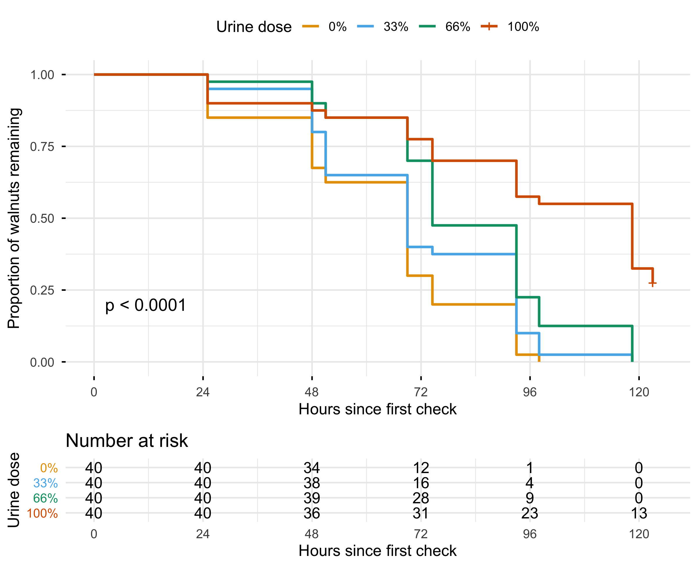
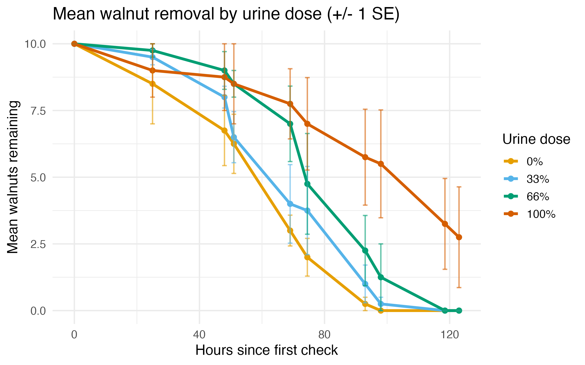

# Predator Odor and Squirrel Foraging: a Dose-Response Field Experiment

Do eastern gray squirrels avoid food that smells of a predator, and does the effect scale with the
strength of the smell? This repository contains the data and R code for a field experiment run at
Emory University's Lullwater Preserve in December 2025. The full write-up is the course paper
*"Don't Pee on My Food!": Concentration-Dependent Effects of Predator Urine on Eastern Gray Squirrel
Foraging Behavior.*

The study is small, but its structure mirrors a dose-finding trial: a pilot to check that the effect is
detectable, a blocked design with four dose levels, repeated follow-up, right-censored time-to-event
outcomes, and a pre-planned comparison of models.

## Design

| | Pilot assay | Main experiment |
|---|---|---|
| Purpose | Is an effect detectable at all? | Does the effect depend on dose? |
| Units | 12 stations, 5 walnuts each | 16 stations (4 blocks × 4 doses), 10 walnuts each |
| Treatment | No urine vs. 100% coyote urine | 0%, 33%, 66%, 100% coyote urine (60 mL per jar) |
| Follow-up | Day 0, 2, 7 | 10 checks over 123 hours |
| Analysis | Welch t test on Day-2 counts | Removal models, ANOVA, Kaplan-Meier, log-rank |

Within each block the four doses sat at the corners of a 50 m × 50 m square, so every block contained
every dose. The pilot's ceiling effect (almost all walnuts gone by Day 7) is why the main experiment
used more frequent checks and a dose gradient.

## Results (as reported in the paper)

- **Pilot:** urine and control stations differed at Day 2 (Welch t test, p = 0.012).
- **Main experiment:** 149 of 160 walnuts were removed; the 11 that remained were all at 100% urine
  stations and are right-censored.
- **Removal model:** a linear decline fitted better than exponential decay at every dose (higher mean
  R², lower mean AIC), so station-level linear slopes were used as removal rates. ANOVA showed that
  the rates differed by dose.
- **Time to removal:** Kaplan-Meier curves separated by dose. In pairwise log-rank tests
  (Benjamini-Hochberg adjusted), 100% differed from every other dose (p < 0.001), 0% differed from 66%
  (p = 0.0003) and 33% differed from 66% (p = 0.043); 0% vs 33% did not (p = 0.093).





## Post-hoc sensitivity analysis (added after the course)

The paper treats each walnut as independent, but walnuts at the same station share the same squirrels
and the same jar. `R/05_sensitivity.R` refits the dose effect with:

- a Cox model stratified by block, with robust standard errors clustered by station;
- a Cox model with a station-level gamma frailty;
- a trend test across the four doses;
- an ANOVA of removal rates with block as a fixed effect.

The dose effect holds once clustering and blocks are accounted for. In the block-stratified Cox model
with station-clustered standard errors, the removal hazard relative to 0% was 0.78 (95% CI 0.52–1.15)
at 33%, 0.46 (0.30–0.71) at 66% and 0.15 (0.07–0.32) at 100%, and each step up in dose multiplied it
by 0.56 (0.46–0.69, robust p < 0.001), with no evidence against proportional hazards (global p = 0.18).
With the station as the unit, dose still explained removal rates after adding block to the ANOVA
(F(3, 9) = 5.42, p = 0.021). The gamma frailty model estimated a between-station variance of
essentially zero and returned the same hazard ratios; because each station is a single block × dose
cell, 16 stations are not enough to estimate the between-station variance, so this model is reported
but not relied on. Full results are in `output/05_*.csv`.

The two outcome scales also disagree in an informative way. Tukey tests on the linear slopes separate
only 100% from the other doses (66% vs 0%: p = 0.98), while the survival analysis also separates 66%
from 0% (adjusted log-rank p = 0.0003). Walnuts at 66% stations were eventually all taken, just later,
and a slope averaged over 123 hours hides that delay. That is the reason to analyse time to removal
rather than removal rate alone.

## Limitations

- **Clustering.** 160 walnuts come from only 16 stations. The station, not the walnut, is the
  independent unit; the sensitivity analysis addresses this.
- **Interval censoring.** A walnut's removal is only known to have happened between two checks; the
  analysis uses the check time. An interval-censored survival model would be more exact.
- **Small sample.** Four blocks per dose limit power, especially for the 0% vs 33% contrast.
- **Assignment.** Doses were placed at fixed corners within each block; the paper does not describe
  randomized assignment.

## Repository layout

```
data/
  BIOL247_Data.xlsx      main experiment: one row per station, one column per check (walnuts remaining)
  pilot_counts.csv       pilot assay counts (Day 0, 2, 7)
R/
  00_setup.R             packages, colours, helpers
  01_pilot_analysis.R    pilot means and Welch t test
  02_prepare_data.R      parse check times, long format, one row per walnut, data checks
  03_removal_models.R    linear vs exponential decay (R², AIC), ANOVA + Tukey on removal rates
  04_survival_analysis.R Kaplan-Meier curves, global and pairwise (BH-adjusted) log-rank tests
  05_sensitivity.R       clustered and frailty Cox models, block-adjusted ANOVA (post hoc)
run_all.R                runs everything
figures/, output/        generated
```

## Reproduce

```r
install.packages(c("readxl", "dplyr", "tidyr", "lubridate", "purrr",
                   "ggplot2", "survival", "survminer"))
```

```sh
Rscript run_all.R
```

## Author

Ziang Zhang, BIOL 247, Emory University (fall 2025). The code was reorganized after the course for
readability; the analyses in scripts 01–04 follow the paper, and script 05 is a later addition.
